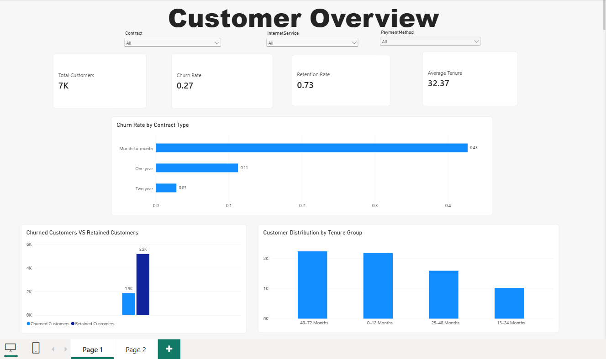
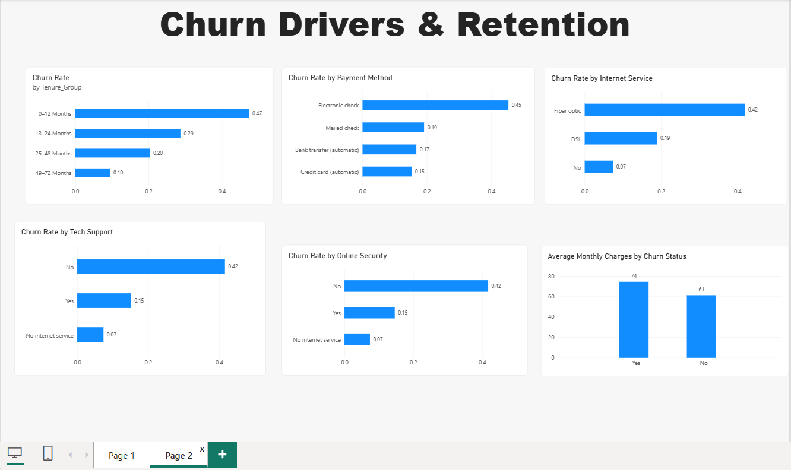

# Customer Retention & Churn Analysis

An end-to-end analysis of telecommunications customer churn, moving from data preparation to repeatable Python analysis and an interactive Power BI report. The project explores customer retention, churn patterns across service and contract groups, and practical questions for further investigation.

## Project workflow

**Excel → Python → Power BI**

### Phase 1 — Excel: data preparation and quality checks

Prepare the customer data and review the cleaning and validation notes before analysis. The cleaned workbook includes `Cleaned_Data`, `Data_Quality_Report`, and `Cleaning_Summary` sheets.

- Raw data: [`data/Raw/WA_Fn-UseC_-Telco-Customer-Churn.csv`](data/Raw/WA_Fn-UseC_-Telco-Customer-Churn.csv)
- Cleaned dataset: [`data/Cleaned/Telco_Customer_Churn_Cleaned.xlsx`](data/Cleaned/Telco_Customer_Churn_Cleaned.xlsx)
- Excel copy: [`excel/Telco_Customer_Churn_Cleaned.xlsx`](excel/Telco_Customer_Churn_Cleaned.xlsx)
- Data preparation and quality notes: see the cleaned workbook's `Data_Quality_Report` and `Cleaning_Summary` sheets.

The prepared dataset contains 7,043 customer records and 21 columns. Blank `TotalCharges` values for zero-tenure customers were converted to zero, and identifiers and churn labels were checked as part of data validation.

### Phase 2 — Python: repeatable churn analysis

The Python script calculates churn and retention KPIs and compares customer segments, including contract, tenure, payment method, internet service, support, and security. It prints the analysis tables to the terminal and saves the results workbook.

- Analysis script: [`python/telco_churn_analysis.py`](python/telco_churn_analysis.py)
- Results workbook: [`reports/Telco_Churn_Analysis_Results.xlsx`](reports/Telco_Churn_Analysis_Results.xlsx)

To run the analysis from the project root:

```powershell
python -m pip install pandas openpyxl
python python/telco_churn_analysis.py
```

The script reads `data/Cleaned/Telco_Customer_Churn_Cleaned.xlsx` and writes the analysis workbook to `reports/`.

### Phase 3 — Power BI: interactive dashboards

Explore customer overview metrics and churn segment comparisons in the two-page interactive report. The screenshots below are static previews; open the `.pbix` file in Power BI Desktop to use the filters.

- Power BI report: [`powerbi/Telco_Customer_Churn_Dashboard.pbix`](powerbi/Telco_Customer_Churn_Dashboard.pbix)

**Customer overview**



**Churn drivers and retention**



The first page summarizes customer, churn, retention, and tenure KPIs. The second compares churn across tenure, payment method, internet service, support, and security.

## Repository contents

```text
data/
  Raw/WA_Fn-UseC_-Telco-Customer-Churn.csv
  Cleaned/Telco_Customer_Churn_Cleaned.xlsx
excel/
  Telco_Customer_Churn_Cleaned.xlsx
powerbi/
  Telco_Customer_Churn_Dashboard.pbix
python/
  telco_churn_analysis.py
reports/
  CUSTOMER RETENTION & CHURN ANALYSIS.docx
  CUSTOMER RETENTION & CHURN ANALYSIS.pdf
  Telco_Customer_Churn_Cleaned.xlsx
  Telco_Churn_Analysis_Results.xlsx
visuals/
  churn_drivers_retention.png
  customer_overview.png
```

## Future implementation roadmap

The current analysis is a descriptive baseline. These are potential next steps—not features already included in the project:

1. **Build a validated churn-risk model.** Establish a simple baseline, use customer-level train/validation/test splits, check class imbalance and leakage, and evaluate calibration, recall, and precision.
2. **Understand when customers leave.** If dated customer histories become available, add cohort or time-to-event analysis instead of treating a one-time snapshot as a trend.
3. **Test retention actions.** Evaluate offers or service changes using controlled experiments or a suitable holdout, measuring incremental retention and cost rather than model scores alone.
4. **Improve ongoing monitoring.** Add clearly defined time-based churn KPIs, cohort tracking, and documented data-quality checks to the dashboard refresh process.

Use appropriate privacy controls for customer-level records, and review model fairness and business constraints before using risk scores to guide customer contact.

## Reports

- [Customer Retention & Churn Analysis — PDF](reports/CUSTOMER%20RETENTION%20%26%20CHURN%20ANALYSIS.pdf)
- [Customer Retention & Churn Analysis — editable Word report](reports/CUSTOMER%20RETENTION%20%26%20CHURN%20ANALYSIS.docx)
- [Cleaned customer data and quality documentation](reports/Telco_Customer_Churn_Cleaned.xlsx)
